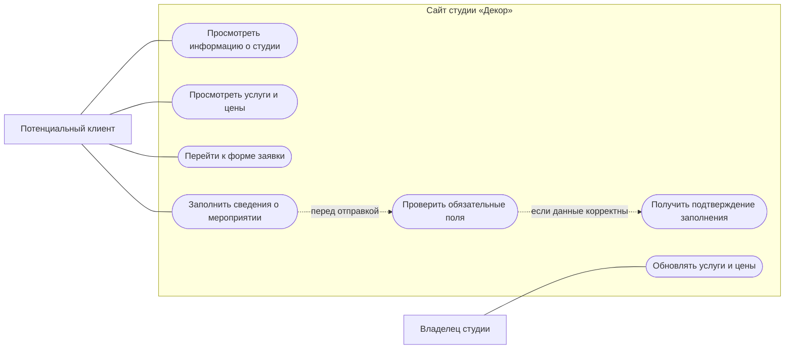
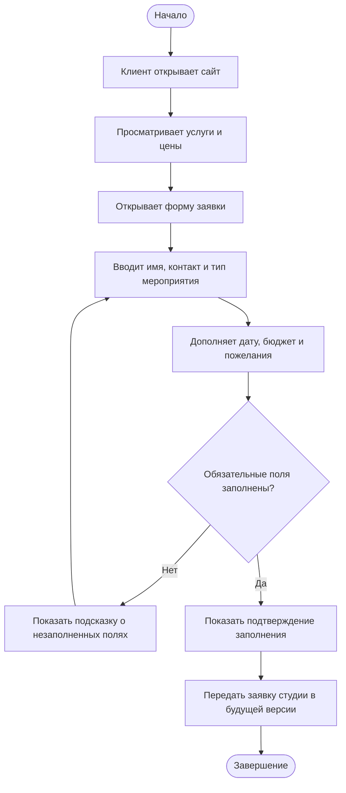
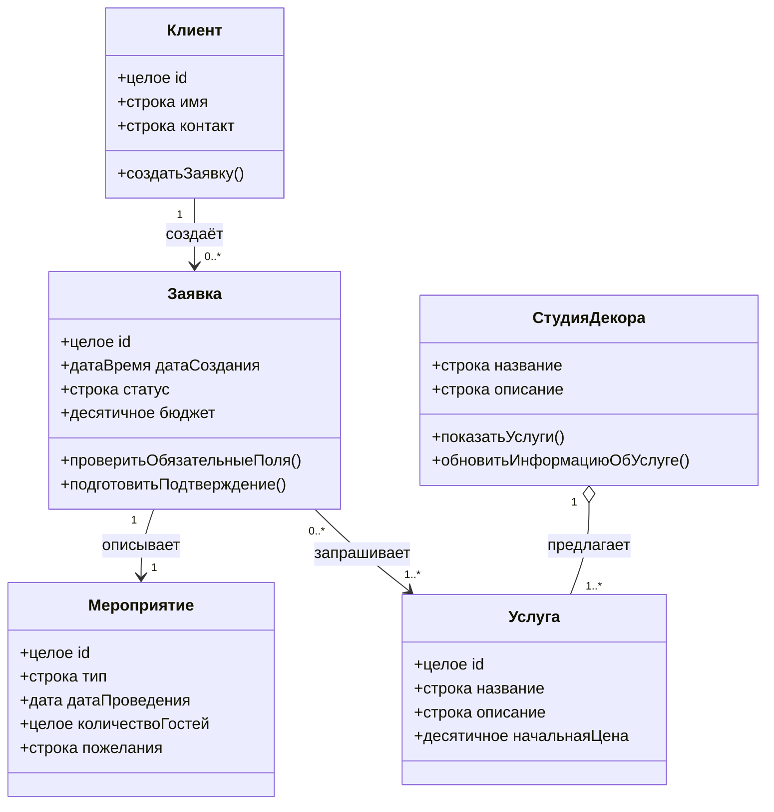

# UML-диаграммы проекта «Декор — оформление мероприятий»

Диаграммы написаны на русском языке в формате Mermaid. Их можно просмотреть в редакторе с поддержкой Mermaid или экспортировать в изображение для отчёта.

## 1. Диаграмма вариантов использования

**Пояснение.** Потенциальный клиент знакомится с услугами и ценами, затем заполняет форму с информацией о мероприятии. Сайт проверяет обязательные поля и показывает подтверждение. Владелец студии в будущей версии сможет обновлять сведения об услугах.

## 2. Диаграмма деятельности — заполнение заявки

**Пояснение.** Клиент изучает услуги и заполняет заявку. Если обязательные поля не заполнены, система предлагает исправить данные. При корректном заполнении отображается подтверждение. Передача заявки студии обозначена как функция будущей версии, поскольку в текущем прототипе сервер отсутствует.

## 3. Диаграмма классов

**Пояснение.** Клиент может создавать заявки на оформление мероприятий. Каждая заявка описывает мероприятие и выбранные услуги. Студия предлагает перечень услуг с описаниями и ориентировочными ценами. Диаграмма описывает предполагаемую предметную модель для дальнейшего развития системы.
